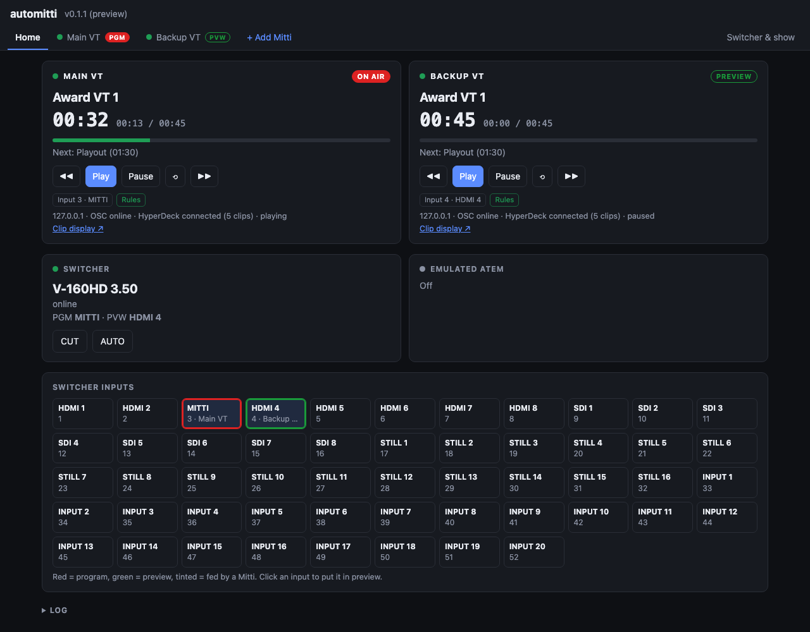
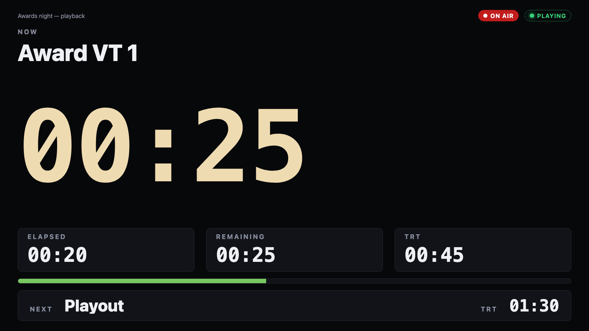

# automitti user guide

**automitti is a menu-bar app that puts Mitti on a switcher Mitti doesn't know about.** Mitti
already follows a Blackmagic ATEM: it rolls when the switcher takes it to air, does something
you chose when it is taken off, and can make the switcher take at the end of a clip. automitti
gives it the same behaviour on a Roland V-160HD, an Analog Way Pulse 4K or Midra 4K, an older
Analog Way Midra or a LiveCore, and does the same for QLab 5. It also sends Mitti's one OSC
feedback stream to as many places as you list, and serves a full-screen clip clock to any
browser.

> **Released at v0.2.0, as a preview: try it with your own equipment before a show depends on
> it.** This is an AI-assisted codebase, directed and reviewed by a human author.
>
> **Run against real equipment:** Mitti 2.8.18 and 2.8.19 (the emulated ATEM, Mitti's own
> Pause at End taken on the switcher, NDI tally, OSC, the HyperDeck clip list); Blackmagic's
> Switcher SDK 10.2.1, which is what Mitti's ATEM integration runs; and **QLab 5.5.10 with Wait
> cues only**.
>
> **Only against simulators:** every switcher. The V-160HD driver has met a simulator written
> from Roland's documents; the Pulse 4K / Midra 4K driver, Analog Way's own simulator; the
> LiveCore and Midra drivers (new in v0.2.0), simulators written from openRCS's findings on a
> real NeXtage 16 and Pulse². **Several Mittis at once** (new in v0.2.0) was run with two Mitti
> simulators on the V-160HD simulator, not with two real Mittis.
>
> **Not verified yet:** a Video cue actually playing in QLab, a QLab on another machine or a
> show-sized QLab workspace; two real Mittis at once; any real switcher with this code; Mitti
> playing on NDI tally rather than receiving it; Windows and Linux, which have no build.

---

## What you need

- A Mac. The download is universal (Apple Silicon and Intel), signed and notarised by Apple, so
  it opens with no Gatekeeper warning.
- **Mitti**, or **QLab 5**, on this Mac or another one on the same network.
- One of the switchers below, on the same network. With none, the **Manual / HTTP** switcher
  lets you set the tally from the page or from Companion.
- For NDI tally only: the NDI runtime, which comes with [NDI Tools](https://ndi.video/tools).
  automitti doesn't bundle it.

| Switcher | How automitti talks to it |
|---|---|
| Roland V-160HD | LAN control, TCP 8023, with the unit's network password |
| Analog Way Pulse 4K / Midra 4K (QuickVu, Pulse, Eikos, QuickMatrix) | AWJ, TCP 10606 |
| Analog Way LiveCore (Ascender 16/32/48, NeXtage 08/16, SmartMatriX Ultra) | Analog Way's mnemonic protocol, TCP 10500 |
| Analog Way Midra (Pulse², Eikos², Saphyr, SmartMatriX², QuickMatriX, QuickVu) | the same protocol, TCP 10500 |
| Manual / HTTP | none: the page, or `POST /api/switcher` |

## Install and start it

1. Open the disk image and drag **automitti** to Applications.
2. Open it. It lives in the menu bar; its window has a **Network interface** and a **Port**
   (8710 unless you change it).
3. Press **Start server**, then **Open**. The control page opens in your browser at
   `http://<this Mac>:8710/`, and any other machine on the network can open the same address.

Everything else is set on that page and saved in
`~/Library/Application Support/automitti/config.json`. It can be changed from a browser on
another machine mid-show without restarting anything. A settings file from v0.1.x is carried
across as the first Mitti.

## The control page

- **Home** shows every Mitti together: its clip and countdown, the next clip, its tally, which
  switcher input it is on and what is driving it (**ATEM**, **NDI** or **Rules**). Below are the
  switcher, with **CUT** and **AUTO**, and its inputs; click an input to put it in preview.
- **A tab per Mitti**, with **+ Add Mitti** beside them. A tab holds that Mitti's settings,
  its transport (previous, **Play**, **Pause**, rewind, next) and cards for its NDI tally, rules
  and feedback relay.
- **Switcher & show** holds what every Mitti shares: the switcher, the emulated ATEM, the
  network and the clip display colours.

Edits are a draft. **Unsaved changes** appears with **Save** and **Discard**; nothing changes
until you save.

## 1. Connect the switcher

In **Switcher & show → Switcher**, choose the switcher and fill in its address. The page shows
its status; once it is online its inputs appear on Home, with their names.

- **V-160HD:** set a 4-character NETWORK PASSWORD on the unit (MENU → LAN CONTROL) and enter it
  here. The unit allows **one** LAN client, so RCS over LAN cannot run at the same time.
- **Pulse 4K / Midra 4K:** optionally limit it to some screens (`S1,S2`), and choose the layer
  that preview and program selects write to.
- **LiveCore:** optionally limit the screens, choose the layer for selects, and set the **take
  time**. A take sweeps the T-bar over that time, because the LiveCore's own take commands stall
  over this protocol; 0 makes it a cut.
- **Midra (Pulse², Eikos²…):** the frame has no input names, so type them in order. A Pulse²
  takes **one** control session: close RCS2 or openRCS first. A Midra refuses an input with no
  signal, and automitti says so when it does.
- **Manual / HTTP:** set the number of inputs. Program and preview come from the page or from
  `POST /api/switcher` with `{"action": "program" | "preview" | "cut" | "auto", "input": n}`,
  which Companion's HTTP action can send.

**What counts as on air.** On the V-160HD, the switcher's own tally. On the Analog Way
switchers, an input is on air while it is a source of a layer in what a screen is showing, and
**during a take both sides count**, so a clip rolls as the mix starts rather than after it.

## 2. Connect Mitti

Open the Mitti's tab and fill in **This Mitti**:

- **Name** — its tab and its clip display title.
- **Its switcher input** — a number or the input's name, such as `3` or `HDMI 3`.
- **Mitti address** — `127.0.0.1` when Mitti is on this Mac. **Mitti OSC port** is 51000.
- **Feedback listen port** — 51010 for the first Mitti. Each Mitti needs its own.
- **Read clips over HyperDeck** — gives the clip display the next clip's running time.

Then, in Mitti:

- **Preferences → OSC:** set *Feedback To* to automitti and the feedback port above. On the same
  Mac, choose **Custom, `127.0.0.1`, port 51010**. Mitti saves an entry picked from its Bonjour
  list (`automitti-51010`) as a bare IP address, so after the Mac changes network Mitti keeps
  sending to the old one and automitti shows it offline.
- **HyperDeck control on**, for the clip durations.

## 3. Choose how Mitti follows the switcher

Pick **one** of these per Mitti. Two at once both act on every take.

| Way | In Mitti | In automitti |
|---|---|---|
| **ATEM** (the most complete) | Integrations → ATEM → *automitti*, and the input it is on | **Switcher & show → Emulate an ATEM** |
| **NDI tally** | Integrations → NDI | the Mitti's tab → **Send NDI tally to this Mitti**, and its NDI source |
| **Rules over OSC** | OSC on (it already is, for feedback) | the Mitti's tab → **Enable rules**, *Send over* OSC |
| **Rules over HyperDeck** | HyperDeck control on | **Enable rules**, *Send over* HyperDeck |

**ATEM.** automitti answers on the network as an ATEM whose inputs, names, program, preview and
tally are the real switcher's. Mitti finds it over Bonjour. Every option Mitti has for an ATEM
then works unchanged, and when Mitti's Pause at End asks for a CUT or an AUTO, the real switcher
does it. Every Mitti can use the one emulated ATEM at once, as several can share a real one. It
uses UDP 9910, one per machine: don't run it where ATEM Software Control is connected to a real
ATEM.

**NDI tally.** automitti joins the Mitti's NDI output as a metadata-only receiver (no video
crosses the network) and reports it on program while its input is on air. **Find NDI sources**
fills in the list.

**Rules.** automitti runs Mitti's ATEM behaviour from its own side:

| Setting | Choices |
|---|---|
| On program | Play · Do nothing |
| On preview | Do nothing · Rewind to the top |
| Taken off air | Do nothing · Pause · Stop and rewind · Stop and load the next cue |
| Cue ends | Do nothing · CUT · AUTO |
| End lead | how many seconds before the end *Cue ends* fires |

## 4. Several Mittis

Press **+ Add Mitti** for a second one — main and backup, or one per kind of content. Each gets
its own tab, switcher input, feedback port, relay list, NDI tally and rules, and each can use a
different one of the ways above. All of them share the one switcher and the one emulated ATEM.

- A new Mitti is given the next free feedback port (51011, 51012…) and appears in Mitti's
  *Feedback To* list as `automitti-51011`. Two Mittis set to the same port are flagged on both.
- Remove a Mitti from the foot of its tab.
- Over HTTP, `POST /api/player` takes `"device"`: the Mitti's id (from its tab's address,
  `#/device/<id>`) or its name. Without it, the request goes to the first Mitti.

New in v0.2.0, and so far run only with **two Mitti simulators** on the V-160HD simulator: a cut
to each one's input rolled that Mitti and only that one. Check it with your own Mittis first.

## 5. QLab instead of Mitti

A Mitti's tab can drive **QLab 5** instead: set **Player** to QLab. QLab has no ATEM or NDI
integration, so the **rules are what roll it** — turn on **Enable rules**. *Play* GOes the cue
list, or resumes a clip that was paused; *Cue ends* takes the switcher off it; *Taken off air*
can pause or stop it.

- **QLab address** and **QLab OSC port** (53000). automitti uses OSC over TCP.
- **OSC passcode.** A new QLab 5 workspace makes up a 4-digit passcode and gives connections
  without one no access. Copy it from *Workspace Settings → Network → OSC Access*; it needs
  **Control** for the rules to work.
- **Workspace** and **Cue list:** empty takes the first workspace open and the current list.
- **Cue types that are clips:** Video unless you add others. Light, audio and fade cues between
  two videos are passed over, and the clip display's *Next* is the next video.

QLab answers nothing while no workspace is open, and the tab says so until one opens. A wrong
passcode locks you out for a few seconds, so automitti tries once and then waits 30 s.

New in v0.2.0, and checked on a real **QLab 5.5.10 with Wait cues only**: joining, play, pause,
resume, stop and rewind, a clip running out, and a take onto QLab's input GOing the cue with its
end AUTOing back. **A Video cue actually playing has not been checked**, nor a pre-wait, a clip
inside a Group, or a QLab on another machine. [QLAB.md](QLAB.md) has the details.

## 6. Send Mitti's feedback on

Mitti sends its OSC feedback to one address. Under **Feedback relay destinations**, **Add
destination** for each thing that wants it — Companion's Mitti module (51001, 51002…), a Stream
Deck, another machine — and every packet is re-sent to each, byte for byte.

## 7. The clip display

Open `http://<this Mac>:8710/display?device=<id or name>` full screen on any browser; each
Mitti's tab links to its own. It shows the current clip, a big countdown, the elapsed time,
running time and a progress bar, the next clip and its running time, and an on-air or preview
chip from the switcher's tally. The countdown turns amber under 30 s and red under 10 s; change
both under **Switcher & show → Clip displays**, with **Show frames**. Add `&frames` to the
address for frames on one screen only.

## When something is wrong

- **Mitti doesn't see the emulated ATEM, or connects to the wrong address.** Mitti uses the
  first IPv4 address Bonjour gives it, which on a Mac with ZeroTier or Tailscale is often the
  VPN. Set **Switcher & show → Network → Announce on address** to the show network.
- **Mitti shows offline after a network change.** Its *Feedback To* is a stale address; see
  [Connect Mitti](#2-connect-mitti).
- **"Answered, but not as a HyperDeck."** ZeroTier owns TCP 9993, the HyperDeck port, so Mitti's
  HyperDeck emulation can't start. Only the next clip's running time is lost, until that clip has
  once been current.
- **The V-160HD won't connect.** Close RCS: the unit takes one LAN client.
- **A Pulse² won't connect.** Close RCS2 or openRCS: it takes one control session.
- **Mitti acts on every take twice.** It has two ways on at once, such as its own ATEM
  integration and automitti's rules. Pick one.
- **"UDP 9910 is in use."** ATEM software or another emulator on this Mac holds the ATEM port,
  and there is one per machine. Close it, or run automitti on another Mac.

Protocol research, the driver contract and how to add your own switcher or player are in the
[README](https://github.com/stoatworks-labs/automitti#readme) and the other files in
[docs/](https://github.com/stoatworks-labs/automitti/tree/main/docs).

Not affiliated with or endorsed by imimot (Mitti), Figure 53 (QLab), Roland, Analog Way,
Blackmagic Design or Vizrt. NDI® is a registered trademark of Vizrt NDI AB
([ndi.video](https://ndi.video)).
